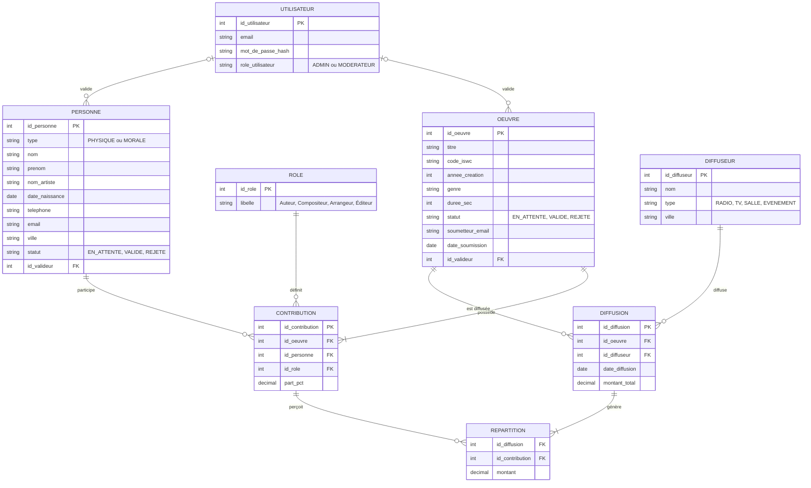

# ny-hirako

> Gestion simplifiée des droits d'auteur pour les artistes malagasy.

*Projet final : Application web avec une base de données relationnelle (échéance : 27 novembre 2026).*

## 1. Problème et objectifs

Les auteurs, compositeurs, arrangeurs et éditeurs malagasy n'ont pas d'outil simple pour :

- enregistrer leurs œuvres musicales ;
- déclarer qui a participé à chaque œuvre et pour quelle part ;
- suivre les diffusions (radio, télévision, salle, événement) et calculer les droits dus à chaque ayant droit.

**ny-hirako** est un MVP qui répond à ce besoin avec une base PostgreSQL et une application web.

## 2. Acteurs et fonctionnalités

| Acteur | Accès | Possibilités |
|---|---|---|
| **Visiteur** | Public, sans compte | Rechercher et consulter les œuvres et ayants droit validés ; soumettre une œuvre via un formulaire |
| **Modérateur** | Connexion requise | Valider ou rejeter les soumissions ; gérer personnes, œuvres, contributions, diffuseurs |
| **Administrateur** | Connexion requise | Tout ce que fait le modérateur, plus la gestion des diffuseurs, des diffusions, des répartitions et des comptes |

Fonctionnalités principales : ajout, consultation, modification, suppression et recherche pour chaque entité, workflow de modération des soumissions, calcul de la répartition des droits par diffusion.

## 3. Stack technique

| Couche | Choix | Justification |
|---|---|---|
| Frontend | Vue 3 + Vite | Framework réactif, léger, rapide à mettre en place |
| Backend | Node.js + Express | API REST simple et rapide à développer |
| Base de données | PostgreSQL | Contraintes d'intégrité robustes (CHECK, triggers, énumérations) |

## 4. Modèle entité-association

### Contraintes d'intégrité prévues

- `part_pct` est compris entre 0 et 100.
- La somme des `part_pct` d'une œuvre vaut 100 (vérifiée à la validation de l'œuvre).
- Un triplet (œuvre, personne, rôle) est unique.
- Seule une personne de type `MORALE` peut avoir le rôle Éditeur.
- Une œuvre ayant des diffusions ne peut pas être supprimée (`ON DELETE RESTRICT`).
- `code_iswc` et `email` (utilisateur) sont uniques.

### Choix de modélisation

- **Répartition stockée** : le montant versé à chaque ayant droit est enregistré, ce qui conserve l'historique même si les parts changent plus tard.
- **Diffuseur séparé** : évite de répéter ses informations dans chaque diffusion.
- **Une seule entité PERSONNE** : auteurs, compositeurs et éditeurs partagent la même table, distingués par leur rôle sur chaque œuvre.

## 5. Schéma relationnel et normalisation

### 5.1 Schéma relationnel

Notation : **clé primaire** en gras, `#` pour les clés étrangères.

- **UTILISATEUR**(**id_utilisateur**, email, mot_de_passe_hash, role_utilisateur)
- **PERSONNE**(**id_personne**, type, nom, prenom, nom_artiste, date_naissance, telephone, email, ville, statut, #id_valideur → UTILISATEUR)
- **ROLE**(**id_role**, libelle)
- **OEUVRE**(**id_oeuvre**, titre, code_iswc, annee_creation, genre, duree_sec, statut, soumetteur_email, date_soumission, #id_valideur → UTILISATEUR)
- **CONTRIBUTION**(**id_contribution**, #id_oeuvre → OEUVRE, #id_personne → PERSONNE, #id_role → ROLE, part_pct)
- **DIFFUSEUR**(**id_diffuseur**, nom, type, ville)
- **DIFFUSION**(**id_diffusion**, #id_oeuvre → OEUVRE, #id_diffuseur → DIFFUSEUR, date_diffusion, montant_total)
- **REPARTITION**(**#id_diffusion** → DIFFUSION, **#id_contribution** → CONTRIBUTION, montant)

### 5.2 Clés étrangères et règles de suppression

| Clé étrangère | Référence | ON DELETE | Raison |
|---|---|---|---|
| PERSONNE.id_valideur | UTILISATEUR | SET NULL | Garder la personne si le modérateur est supprimé |
| OEUVRE.id_valideur | UTILISATEUR | SET NULL | Idem |
| CONTRIBUTION.id_oeuvre | OEUVRE | CASCADE | Les contributions n'existent pas sans l'œuvre |
| CONTRIBUTION.id_personne | PERSONNE | RESTRICT | Pas de suppression d'un ayant droit qui a des contributions |
| CONTRIBUTION.id_role | ROLE | RESTRICT | Les rôles sont des données de référence |
| DIFFUSION.id_oeuvre | OEUVRE | RESTRICT | Une œuvre diffusée ne peut pas être supprimée |
| DIFFUSION.id_diffuseur | DIFFUSEUR | RESTRICT | Conserver l'historique des diffusions |
| REPARTITION.id_diffusion | DIFFUSION | CASCADE | La répartition dépend de la diffusion |
| REPARTITION.id_contribution | CONTRIBUTION | RESTRICT | Conserver l'historique des paiements |

Contraintes d'unicité : `UTILISATEUR.email`, `ROLE.libelle`, `OEUVRE.code_iswc`, `DIFFUSEUR(nom, ville)`, `CONTRIBUTION(id_oeuvre, id_personne, id_role)`.

### 5.3 Dépendances fonctionnelles

| Relation | Dépendances fonctionnelles | Clés candidates |
|---|---|---|
| UTILISATEUR | id_utilisateur → email, mot_de_passe_hash, role_utilisateur ; email → id_utilisateur | id_utilisateur, email |
| PERSONNE | id_personne → type, nom, prenom, nom_artiste, date_naissance, telephone, email, ville, statut, id_valideur | id_personne |
| ROLE | id_role → libelle ; libelle → id_role | id_role, libelle |
| OEUVRE | id_oeuvre → titre, code_iswc, annee_creation, genre, duree_sec, statut, soumetteur_email, date_soumission, id_valideur ; code_iswc → id_oeuvre | id_oeuvre, code_iswc |
| CONTRIBUTION | id_contribution → id_oeuvre, id_personne, id_role, part_pct ; (id_oeuvre, id_personne, id_role) → id_contribution, part_pct | id_contribution, (id_oeuvre, id_personne, id_role) |
| DIFFUSEUR | id_diffuseur → nom, type, ville ; (nom, ville) → id_diffuseur, type | id_diffuseur, (nom, ville) |
| DIFFUSION | id_diffusion → id_oeuvre, id_diffuseur, date_diffusion, montant_total | id_diffusion |
| REPARTITION | (id_diffusion, id_contribution) → montant | (id_diffusion, id_contribution) |

### 5.4 Justification de la normalisation (jusqu'à BCNF)

- **1NF** : tous les attributs sont atomiques. Les rôles d'une personne ne sont pas stockés dans une liste mais dans CONTRIBUTION, une ligne par rôle.
- **2NF** : aucune dépendance partielle. Les seules clés composées sont celles de REPARTITION et la clé alternative de CONTRIBUTION, et dans les deux cas les attributs non-clés (`montant`, `part_pct`) dépendent de la clé entière.
- **3NF** : aucune dépendance transitive entre attributs non-clés. Les informations du diffuseur, de l'œuvre ou du rôle sont dans leurs propres tables et ne sont pas recopiées ailleurs.
- **BCNF** : pour chaque dépendance fonctionnelle non triviale du tableau 5.3, le membre gauche est une clé candidate (donc une super-clé) de sa relation.

**Ce qui violerait la BCNF** (et que le schéma évite) :

- Stocker `nom_diffuseur` et `ville_diffuseur` directement dans DIFFUSION créerait la dépendance id_diffuseur → nom, ville avec un déterminant qui n'est pas une clé de DIFFUSION. D'où la table DIFFUSEUR séparée.
- Stocker `libelle_role` dans CONTRIBUTION créerait id_role → libelle hors clé. D'où la table ROLE.
- Stocker à la fois `nom` et `email` du soumetteur dans OEUVRE créerait email → nom. D'où le seul attribut `soumetteur_email`.

### 5.5 Contraintes hors dépendances fonctionnelles

Certaines règles métier ne s'expriment pas par une dépendance fonctionnelle et sont donc appliquées par des `CHECK` ou des triggers PostgreSQL :

- `part_pct` entre 0 et 100 (`CHECK`).
- Somme des parts d'une œuvre égale à 100, vérifiée à la validation de l'œuvre (trigger).
- Seule une personne `MORALE` peut avoir le rôle Éditeur (trigger).
- Une ligne de REPARTITION doit référencer une contribution de la même œuvre que la diffusion (trigger). Le `montant` est dérivé de `montant_total × part_pct`, mais cette relation entre plusieurs tables n'est pas une dépendance fonctionnelle interne à REPARTITION, donc elle ne remet pas en cause la BCNF.

## 6. Installation et lancement

*À compléter.*

## 7. Création et remplissage de la base

*À compléter.*

## 8. Captures d'écran

*À compléter.*

## 9. Tests et démonstration

*À compléter.*
