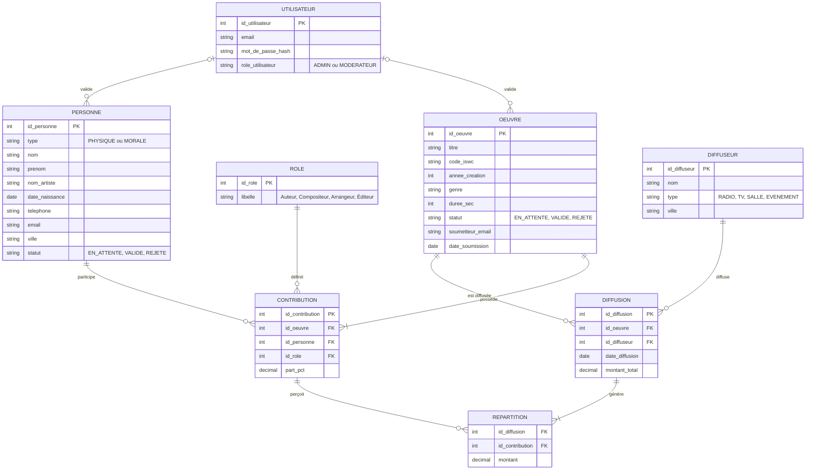

# ny-hirako

> Gestion simplifiée des droits d'auteur pour les artistes malagasy (MVP inspiré de la SACEM).

*Projet final : Application web avec une base de données relationnelle (échéance : 27 novembre 2026).*

## 1. Problème et objectifs

Les auteurs, compositeurs, arrangeurs et éditeurs malagasy n'ont pas d'outil simple pour :

- enregistrer leurs œuvres musicales ;
- déclarer qui a participé à chaque œuvre et pour quelle part ;
- suivre les diffusions (radio, télévision, salle, événement) et calculer les droits dus à chaque ayant droit.

**ny-hirako** est un MVP qui répond à ce besoin avec une base PostgreSQL et une application web.

## 2. Acteurs et fonctionnalités

| Acteur | Accès | Possibilités |
|---|---|---|
| **Visiteur** | Public, sans compte | Rechercher et consulter les œuvres et ayants droit validés ; soumettre une œuvre via un formulaire |
| **Modérateur** | Connexion requise | Valider ou rejeter les soumissions ; gérer personnes, œuvres, contributions, diffuseurs |
| **Administrateur** | Connexion requise | Tout ce que fait le modérateur, plus la gestion des diffuseurs, des diffusions, des répartitions et des comptes |

Fonctionnalités principales : ajout, consultation, modification, suppression et recherche pour chaque entité, workflow de modération des soumissions, calcul de la répartition des droits par diffusion.

## 3. Stack technique

| Couche | Choix | Justification |
|---|---|---|
| Frontend | Vue 3 + Vite | Framework réactif, léger, rapide à mettre en place |
| Backend | Node.js + Express | API REST simple et rapide à développer |
| Base de données | PostgreSQL | Contraintes d'intégrité robustes (CHECK, triggers, énumérations) |

## 4. Modèle entité-association

### Contraintes d'intégrité prévues

- `part_pct` est compris entre 0 et 100.
- La somme des `part_pct` d'une œuvre vaut 100 (vérifiée à la validation de l'œuvre).
- Un triplet (œuvre, personne, rôle) est unique.
- Seule une personne de type `MORALE` peut avoir le rôle Éditeur.
- Une œuvre ayant des diffusions ne peut pas être supprimée (`ON DELETE RESTRICT`).
- `code_iswc` et `email` (utilisateur) sont uniques.

### Choix de modélisation

- **Répartition stockée** : le montant versé à chaque ayant droit est enregistré, ce qui conserve l'historique même si les parts changent plus tard.
- **Diffuseur séparé** : évite de répéter ses informations dans chaque diffusion.
- **Une seule entité PERSONNE** : auteurs, compositeurs et éditeurs partagent la même table, distingués par leur rôle sur chaque œuvre.

## 5. Schéma relationnel et normalisation

*À compléter (étape suivante).*

## 6. Installation et lancement

*À compléter.*

## 7. Création et remplissage de la base

*À compléter.*

## 8. Captures d'écran

*À compléter.*

## 9. Tests et démonstration

*À compléter.*
