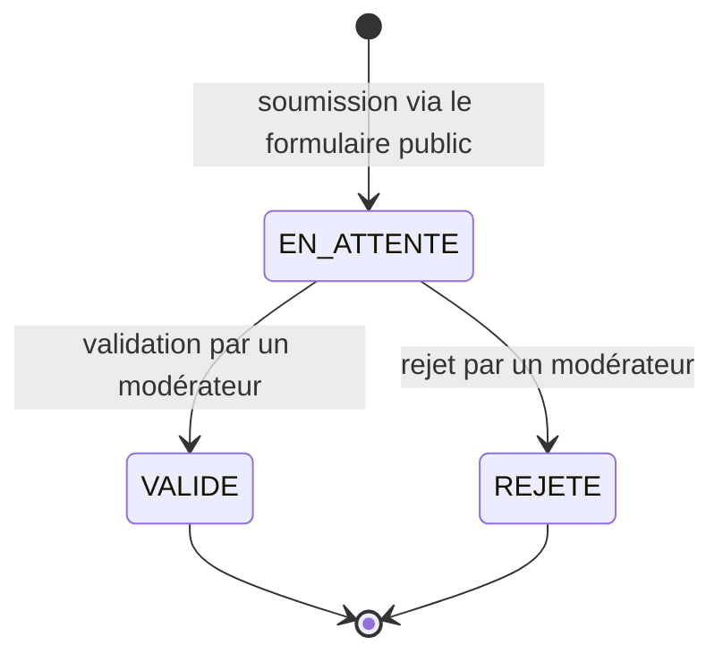
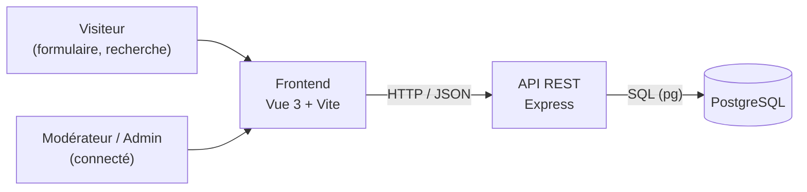
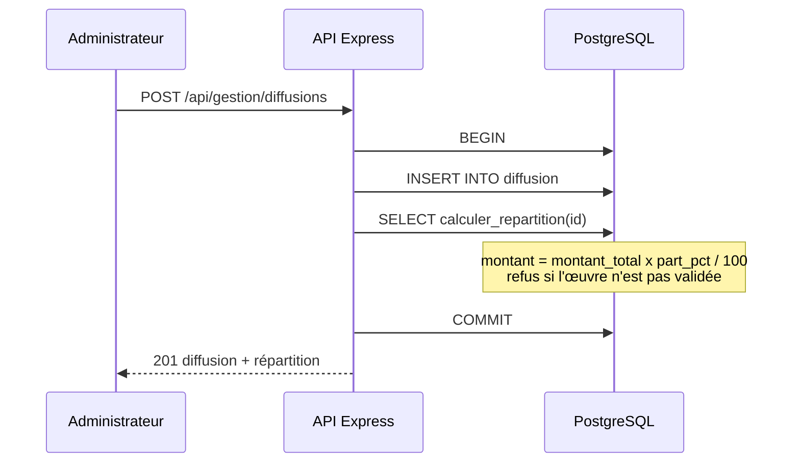
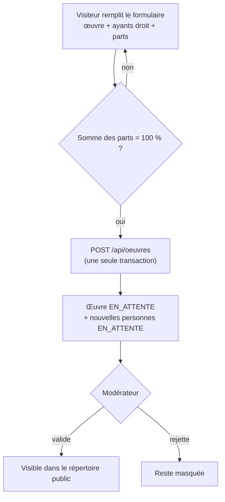

# ny-hirako

> Gestion simplifiée des droits d'auteur pour les artistes malagasy.

*Projet final : Application web avec une base de données relationnelle (échéance : 27 novembre 2026).*

## 1. Problème et objectifs

Les auteurs, compositeurs, arrangeurs et éditeurs malagasy n'ont pas d'outil simple pour :

- enregistrer leurs œuvres musicales ;
- déclarer qui a participé à chaque œuvre et pour quelle part ;
- suivre les diffusions (radio, télévision, salle, événement) et calculer les droits dus à chaque ayant droit.

**ny-hirako** est un MVP qui répond à ce besoin avec une base PostgreSQL et une application web.

## 2. Acteurs et fonctionnalités

| Acteur | Accès | Possibilités |
|---|---|---|
| **Visiteur** | Public, sans compte | Rechercher et consulter les œuvres et ayants droit validés ; soumettre une œuvre via un formulaire |
| **Modérateur** | Connexion requise | Valider ou rejeter les soumissions ; gérer les personnes, les œuvres et leurs contributions |
| **Administrateur** | Connexion requise | Tout ce que fait le modérateur, plus la gestion des diffuseurs, des diffusions, des répartitions de droits et des comptes |

Fonctionnalités principales : ajout, consultation, modification, suppression et recherche pour chaque entité, workflow de modération des soumissions, calcul de la répartition des droits par diffusion.

Cycle de vie d'une soumission (œuvre ou personne) :



Une œuvre ne peut être validée que si la somme des parts de ses contributions vaut 100 et si tous ses ayants droit sont déjà validés.

## 3. Stack technique

| Couche | Choix | Justification |
|---|---|---|
| Frontend | Vue 3 + Vite | Framework réactif, léger, rapide à mettre en place |
| Backend | Node.js + Express | API REST simple et rapide à développer |
| Base de données | PostgreSQL | Contraintes d'intégrité robustes (CHECK, triggers, énumérations) |



L'intégrité des données est garantie par la base elle-même (contraintes, triggers) : l'API se contente de traduire les erreurs PostgreSQL en réponses HTTP claires.

### Charte graphique

Interface claire et institutionnelle, pensée comme un tableau de bord professionnel pour l'industrie musicale.

| Rôle | Couleur | Usage |
|---|---|---|
| Primaire | `#172554` bleu marine | Titres, boutons principaux, bandeau d'accueil |
| Secondaire | `#3156A6` bleu roi | Liens, focus, barres de répartition |
| Accent | `#D6A84F` or | Détails distinctifs (jamais pour du texte fin) |
| Fond | `#F8FAFC` | Arrière-plan des pages |
| Cartes | `#FFFFFF` | Blocs de contenu |
| Texte | `#1E293B` | Texte courant |
| États | vert, ambre, rouge | Succès, attente de validation, erreurs |

Typographie : *Fraunces* (titres) et *Inter* (texte), chargées depuis Google Fonts avec repli automatique sur les polices du système. Toutes les couleurs sont des variables CSS définies en tête de `frontend/src/style.css`. L'interface s'adapte aux écrans d'ordinateur, de tablette et de téléphone.

## 4. Modèle entité-association


### Contraintes d'intégrité prévues

- `part_pct` est compris entre 0 et 100.
- La somme des `part_pct` d'une œuvre vaut 100 (vérifiée à la validation de l'œuvre).
- Un triplet (œuvre, personne, rôle) est unique.
- Seule une personne de type `MORALE` peut avoir le rôle Éditeur.
- Une œuvre ayant des diffusions ne peut pas être supprimée (`ON DELETE RESTRICT`).
- `code_iswc` et `email` (utilisateur) sont uniques.

### Choix de modélisation

- **Répartition stockée** : le montant versé à chaque ayant droit est enregistré, ce qui conserve l'historique même si les parts changent plus tard.
- **Diffuseur séparé** : évite de répéter ses informations dans chaque diffusion.
- **Une seule entité PERSONNE** : auteurs, compositeurs et éditeurs partagent la même table, distingués par leur rôle sur chaque œuvre.

## 5. Schéma relationnel et normalisation

### 5.1 Schéma relationnel

Notation : **clé primaire** en gras, `#` pour les clés étrangères.

- **UTILISATEUR**(**id_utilisateur**, email, mot_de_passe_hash, role_utilisateur)
- **PERSONNE**(**id_personne**, type, nom, prenom, nom_artiste, date_naissance, telephone, email, ville, statut, #id_valideur → UTILISATEUR)
- **ROLE**(**id_role**, libelle)
- **OEUVRE**(**id_oeuvre**, titre, code_iswc, annee_creation, genre, duree_sec, statut, soumetteur_email, date_soumission, #id_valideur → UTILISATEUR)
- **CONTRIBUTION**(**id_contribution**, #id_oeuvre → OEUVRE, #id_personne → PERSONNE, #id_role → ROLE, part_pct)
- **DIFFUSEUR**(**id_diffuseur**, nom, type, ville)
- **DIFFUSION**(**id_diffusion**, #id_oeuvre → OEUVRE, #id_diffuseur → DIFFUSEUR, date_diffusion, montant_total)
- **REPARTITION**(**#id_diffusion** → DIFFUSION, **#id_contribution** → CONTRIBUTION, montant)

### 5.2 Clés étrangères et règles de suppression

| Clé étrangère | Référence | ON DELETE | Raison |
|---|---|---|---|
| PERSONNE.id_valideur | UTILISATEUR | SET NULL | Garder la personne si le modérateur est supprimé |
| OEUVRE.id_valideur | UTILISATEUR | SET NULL | Idem |
| CONTRIBUTION.id_oeuvre | OEUVRE | CASCADE | Les contributions n'existent pas sans l'œuvre |
| CONTRIBUTION.id_personne | PERSONNE | RESTRICT | Pas de suppression d'un ayant droit qui a des contributions |
| CONTRIBUTION.id_role | ROLE | RESTRICT | Les rôles sont des données de référence |
| DIFFUSION.id_oeuvre | OEUVRE | RESTRICT | Une œuvre diffusée ne peut pas être supprimée |
| DIFFUSION.id_diffuseur | DIFFUSEUR | RESTRICT | Conserver l'historique des diffusions |
| REPARTITION.id_diffusion | DIFFUSION | CASCADE | La répartition dépend de la diffusion |
| REPARTITION.id_contribution | CONTRIBUTION | RESTRICT | Conserver l'historique des paiements |

Contraintes d'unicité : `UTILISATEUR.email`, `ROLE.libelle`, `OEUVRE.code_iswc`, `DIFFUSEUR(nom, ville)`, `CONTRIBUTION(id_oeuvre, id_personne, id_role)`.

### 5.3 Dépendances fonctionnelles

| Relation | Dépendances fonctionnelles | Clés candidates |
|---|---|---|
| UTILISATEUR | id_utilisateur → email, mot_de_passe_hash, role_utilisateur ; email → id_utilisateur | id_utilisateur, email |
| PERSONNE | id_personne → type, nom, prenom, nom_artiste, date_naissance, telephone, email, ville, statut, id_valideur | id_personne |
| ROLE | id_role → libelle ; libelle → id_role | id_role, libelle |
| OEUVRE | id_oeuvre → titre, code_iswc, annee_creation, genre, duree_sec, statut, soumetteur_email, date_soumission, id_valideur ; code_iswc → id_oeuvre | id_oeuvre, code_iswc |
| CONTRIBUTION | id_contribution → id_oeuvre, id_personne, id_role, part_pct ; (id_oeuvre, id_personne, id_role) → id_contribution, part_pct | id_contribution, (id_oeuvre, id_personne, id_role) |
| DIFFUSEUR | id_diffuseur → nom, type, ville ; (nom, ville) → id_diffuseur, type | id_diffuseur, (nom, ville) |
| DIFFUSION | id_diffusion → id_oeuvre, id_diffuseur, date_diffusion, montant_total | id_diffusion |
| REPARTITION | (id_diffusion, id_contribution) → montant | (id_diffusion, id_contribution) |

### 5.4 Justification de la normalisation (jusqu'à BCNF)

- **1NF** : tous les attributs sont atomiques. Les rôles d'une personne ne sont pas stockés dans une liste mais dans CONTRIBUTION, une ligne par rôle.
- **2NF** : aucune dépendance partielle. Les seules clés composées sont celles de REPARTITION et la clé alternative de CONTRIBUTION, et dans les deux cas les attributs non-clés (`montant`, `part_pct`) dépendent de la clé entière.
- **3NF** : aucune dépendance transitive entre attributs non-clés. Les informations du diffuseur, de l'œuvre ou du rôle sont dans leurs propres tables et ne sont pas recopiées ailleurs.
- **BCNF** : pour chaque dépendance fonctionnelle non triviale du tableau 5.3, le membre gauche est une clé candidate (donc une super-clé) de sa relation.

**Ce qui violerait la BCNF** (et que le schéma évite) :

- Stocker `nom_diffuseur` et `ville_diffuseur` directement dans DIFFUSION créerait la dépendance id_diffuseur → nom, ville avec un déterminant qui n'est pas une clé de DIFFUSION. D'où la table DIFFUSEUR séparée.
- Stocker `libelle_role` dans CONTRIBUTION créerait id_role → libelle hors clé. D'où la table ROLE.
- Stocker à la fois `nom` et `email` du soumetteur dans OEUVRE créerait email → nom. D'où le seul attribut `soumetteur_email`.

### 5.5 Contraintes hors dépendances fonctionnelles

Certaines règles métier ne s'expriment pas par une dépendance fonctionnelle et sont donc appliquées par des `CHECK` ou des triggers PostgreSQL :

- `part_pct` entre 0 et 100 (`CHECK`).
- Somme des parts d'une œuvre égale à 100, vérifiée à la validation de l'œuvre (trigger).
- Seule une personne `MORALE` peut avoir le rôle Éditeur (trigger).
- Une œuvre validée ne peut contenir que des ayants droit validés, et une personne liée à une œuvre validée ne peut plus être rejetée (triggers).
- Une personne qui est éditeur d'une œuvre ne peut pas devenir une personne physique (trigger).
- Une ligne de REPARTITION doit référencer une contribution de la même œuvre que la diffusion (trigger). Le `montant` est dérivé de `montant_total × part_pct`, mais cette relation entre plusieurs tables n'est pas une dépendance fonctionnelle interne à REPARTITION, donc elle ne remet pas en cause la BCNF.

## 6. Installation et lancement

### Prérequis

- Node.js 20.6 ou plus
- PostgreSQL 13 ou plus, avec la base créée et remplie (voir section 7)

### Structure du dépôt

```
ny-hirako/
├── db/
│   ├── schema.sql        # création de la base
│   ├── seed.sql          # données d'exemple
│   └── migrations/       # modifications à appliquer sur une base existante
├── backend/              # API Express
│   ├── src/
│   │   ├── config.js     # variables d'environnement
│   │   ├── db.js         # pool PostgreSQL et transactions
│   │   ├── app.js        # application Express
│   │   ├── index.js      # démarrage du serveur
│   │   ├── middleware/   # authentification JWT, gestion des erreurs
│   │   ├── routes/       # routes de l'API
│   │   └── utils/
│   └── .env.example
└── frontend/             # application Vue 3 + Vite
    ├── vite.config.js    # proxy /api vers l'API Express
    └── src/
        ├── api/          # client HTTP (jeton JWT, erreurs)
        ├── composables/  # état de connexion partagé
        ├── layouts/      # mise en page de l'espace de gestion (barre latérale)
        ├── router/       # routes et protection des pages
        ├── views/        # pages
        └── components/   # composants réutilisables
```

### Backend (API)

```bash
cd backend
npm install express pg bcryptjs jsonwebtoken cors
cp .env.example .env      # puis adapter DATABASE_URL et JWT_SECRET
npm run dev
```

L'API écoute par défaut sur `http://localhost:3000`.

### Tester l'API

```bash
# L'API et la base répondent
curl http://localhost:3000/api/health

# Connexion d'un administrateur (renvoie un jeton JWT)
curl -X POST http://localhost:3000/api/auth/login \
  -H "Content-Type: application/json" \
  -d '{"email":"admin@nyhirako.example","password":"Admin123!"}'

# Utilisateur connecté (remplacer <jeton> par le jeton reçu)
curl http://localhost:3000/api/auth/me -H "Authorization: Bearer <jeton>"
```

### Routes des œuvres

| Méthode | Route | Accès | Description |
|---|---|---|---|
| GET | `/api/oeuvres?q=&genre=&annee=&page=&limit=` | Public | Recherche dans les œuvres **validées** (par titre ou par nom d'ayant droit) |
| GET | `/api/oeuvres/:id` | Public | Détail d'une œuvre validée avec ses contributions |
| POST | `/api/oeuvres` | Public | Formulaire de soumission : crée l'œuvre en `EN_ATTENTE` |
| GET | `/api/gestion/oeuvres?statut=&q=` | Modérateur / Admin | Liste de toutes les œuvres, tous statuts |
| GET | `/api/gestion/oeuvres/:id` | Modérateur / Admin | Détail avec les informations de soumission et le statut de chaque ayant droit |
| POST | `/api/gestion/oeuvres` | Modérateur / Admin | Création directe |
| PUT | `/api/gestion/oeuvres/:id` | Modérateur / Admin | Modification (les contributions sont remplacées si elles sont fournies) |
| PATCH | `/api/gestion/oeuvres/:id/statut` | Modérateur / Admin | Validation ou rejet : `{"statut": "VALIDE"}` |
| DELETE | `/api/gestion/oeuvres/:id` | Modérateur / Admin | Suppression (refusée si l'œuvre a des diffusions) |

Une soumission peut référencer un ayant droit existant (`id_personne`) ou en créer un nouveau (`nouvelle_personne`), qui reste `EN_ATTENTE` jusqu'à sa validation.

```bash
# Recherche publique
curl "http://localhost:3000/api/oeuvres?q=salegy"
curl "http://localhost:3000/api/oeuvres?q=hery"

# Soumission publique (un ayant droit existant + un nouveau)
curl -X POST http://localhost:3000/api/oeuvres \
  -H "Content-Type: application/json" \
  -d '{
    "titre": "Mamelombelona", "genre": "Salegy", "annee_creation": 2025,
    "duree_sec": 210, "soumetteur_email": "test@example.com",
    "contributions": [
      {"id_personne": 1, "id_role": 2, "part_pct": 60},
      {"nouvelle_personne": {"type": "PHYSIQUE", "nom": "Rakoto", "prenom": "Jean"}, "id_role": 1, "part_pct": 40}
    ]
  }'

# Modération (avec le jeton obtenu au login dans $TOKEN)
curl "http://localhost:3000/api/gestion/oeuvres?statut=EN_ATTENTE" -H "Authorization: Bearer $TOKEN"
curl -X PATCH http://localhost:3000/api/gestion/oeuvres/9/statut \
  -H "Authorization: Bearer $TOKEN" -H "Content-Type: application/json" \
  -d '{"statut": "VALIDE"}'
```

La dernière commande est refusée (422) tant que l'ayant droit « Rakoto Jean » n'a pas été validé : c'est la règle appliquée par le trigger `trg_valider_oeuvre`.

### Routes des personnes et des rôles

| Méthode | Route | Accès | Description |
|---|---|---|---|
| GET | `/api/roles` | Public | Liste des rôles (pour le formulaire de soumission) |
| GET | `/api/personnes?q=&type=&ville=&page=&limit=` | Public | Recherche parmi les ayants droit **validés** (sans email, téléphone ni date de naissance) |
| GET | `/api/personnes/:id` | Public | Fiche d'un ayant droit avec ses œuvres validées |
| GET | `/api/gestion/personnes?statut=&q=&type=` | Modérateur / Admin | Liste de tous les ayants droit, tous statuts |
| GET | `/api/gestion/personnes/:id` | Modérateur / Admin | Fiche complète avec coordonnées et toutes les œuvres |
| POST | `/api/gestion/personnes` | Modérateur / Admin | Création (statut `VALIDE` directement) |
| PUT | `/api/gestion/personnes/:id` | Modérateur / Admin | Modification |
| PATCH | `/api/gestion/personnes/:id/statut` | Modérateur / Admin | Validation ou rejet : `{"statut": "VALIDE"}` |
| DELETE | `/api/gestion/personnes/:id` | Modérateur / Admin | Suppression (refusée si la personne a des contributions) |

```bash
# Rôles et recherche publique
curl http://localhost:3000/api/roles
curl "http://localhost:3000/api/personnes?q=njaka"
curl http://localhost:3000/api/personnes/1

# Modération : ayants droit en attente, puis validation
curl "http://localhost:3000/api/gestion/personnes?statut=EN_ATTENTE" -H "Authorization: Bearer $TOKEN"
curl -X PATCH http://localhost:3000/api/gestion/personnes/12/statut \
  -H "Authorization: Bearer $TOKEN" -H "Content-Type: application/json" \
  -d '{"statut": "VALIDE"}'
```

Pour une base déjà créée avant l'ajout des règles sur les ayants droit : `psql -d nyhirako -f db/migrations/001_regles_personnes.sql`.

### Routes des diffuseurs, diffusions et droits (administrateurs)

| Méthode | Route | Description |
|---|---|---|
| GET / POST | `/api/gestion/diffuseurs` | Liste (`q`, `type`, `ville`) et création |
| GET / PUT / DELETE | `/api/gestion/diffuseurs/:id` | Fiche, modification, suppression (refusée s'il a des diffusions) |
| GET | `/api/gestion/diffusions?id_oeuvre=&id_diffuseur=&date_debut=&date_fin=` | Liste filtrée des diffusions |
| POST | `/api/gestion/diffusions` | Enregistre une diffusion **et calcule la répartition** des droits |
| GET | `/api/gestion/diffusions/:id` | Diffusion avec le détail de sa répartition |
| PUT | `/api/gestion/diffusions/:id` | Modifie diffuseur, date ou montant, puis recalcule la répartition |
| POST | `/api/gestion/diffusions/:id/repartition` | Recalcule la répartition |
| DELETE | `/api/gestion/diffusions/:id` | Supprime la diffusion et sa répartition |
| GET | `/api/gestion/droits/personnes?q=` | Classement des ayants droit par total de droits perçus |
| GET | `/api/gestion/droits/personnes/:id` | Détail des droits d'un ayant droit, diffusion par diffusion |
| GET | `/api/gestion/statistiques` | Chiffres du tableau de bord (modérateurs et admins ; les montants sont réservés aux admins) |

Création d'une diffusion :



```bash
# Diffuseurs et diffusions existants
curl http://localhost:3000/api/gestion/diffuseurs -H "Authorization: Bearer $TOKEN"
curl "http://localhost:3000/api/gestion/diffusions?id_oeuvre=1" -H "Authorization: Bearer $TOKEN"

# Nouvelle diffusion de l'œuvre 1 : 200 000 Ar -> 80 000 / 80 000 / 40 000
curl -X POST http://localhost:3000/api/gestion/diffusions \
  -H "Authorization: Bearer $TOKEN" -H "Content-Type: application/json" \
  -d '{"id_oeuvre": 1, "id_diffuseur": 1, "date_diffusion": "2026-11-20", "montant_total": 200000}'

# Même chose pour l'œuvre 7, non validée : refusé (422), rien n'est créé
curl -X POST http://localhost:3000/api/gestion/diffusions \
  -H "Authorization: Bearer $TOKEN" -H "Content-Type: application/json" \
  -d '{"id_oeuvre": 7, "id_diffuseur": 1, "date_diffusion": "2026-11-20", "montant_total": 100000}'

# Classement des droits et détail pour un ayant droit
curl http://localhost:3000/api/gestion/droits/personnes -H "Authorization: Bearer $TOKEN"
curl http://localhost:3000/api/gestion/droits/personnes/1 -H "Authorization: Bearer $TOKEN"
```

Les montants sont exprimés en Ariary et renvoyés sous forme de chaînes (`"80000.00"`) pour éviter toute perte de précision.

### Gestion des erreurs

L'API traduit les erreurs PostgreSQL en codes HTTP :

| Erreur PostgreSQL | Code HTTP | Exemple |
|---|---|---|
| Violation d'unicité | 409 | Code ISWC déjà utilisé |
| Clé étrangère : élément encore utilisé | 409 | Suppression d'une œuvre déjà diffusée |
| Clé étrangère : référence inexistante | 422 | `id_diffuseur` qui n'existe pas |
| `CHECK` ou trigger | 422 | Somme des parts différente de 100 |
| Valeur invalide ou champ manquant | 400 | Statut inconnu |

### Frontend

```bash
cd frontend
npm install
npm run dev
```

L'application est disponible sur `http://localhost:5173`. L'API doit tourner en parallèle sur le port 3000 : en développement, Vite redirige automatiquement les appels `/api` vers elle (voir `vite.config.js`), donc aucune configuration supplémentaire n'est nécessaire.

| Page | Adresse | Accès |
|---|---|---|
| Répertoire des œuvres (recherche) | `/` | Public |
| Détail d'une œuvre | `/oeuvres/:id` | Public |
| Formulaire de soumission d'une œuvre | `/soumettre` | Public |
| Connexion | `/connexion` | Public |
| Tableau de bord (chiffres, éléments à traiter) | `/gestion` | Modérateur / Admin |
| Œuvres : liste, détail, validation, rejet, suppression | `/gestion/oeuvres`, `/gestion/oeuvres/:id` | Modérateur / Admin |
| Ayants droit : liste, détail, validation, rejet, suppression | `/gestion/personnes`, `/gestion/personnes/:id` | Modérateur / Admin |

#### Espace de gestion

Après connexion, les modérateurs et administrateurs arrivent sur un tableau de bord à barre latérale (menu fixe sur ordinateur, tiroir sur téléphone) : chiffres clés, soumissions à traiter, puis écrans de validation.

- **Œuvres** et **Ayants droit** : onglets par statut (En attente, Validées, Rejetées, Toutes), recherche, validation ou rejet en un clic. Le filtre est conservé dans l'adresse (`?statut=EN_ATTENTE`).
- **Fiche d'une œuvre** : répartition des parts avec le statut de chaque ayant droit. Si certains ne sont pas encore validés, un bouton permet de tous les valider avant de valider l'œuvre.
- Les règles métier restent appliquées par la base (par exemple, une œuvre ne peut pas être validée si la somme des parts n'est pas de 100 %) : l'interface se contente d'afficher le message d'erreur.
- Les pastilles de la barre latérale indiquent le nombre d'éléments en attente.

#### Parcours de soumission

Le formulaire public permet à n'importe quel visiteur de proposer une œuvre. Il contrôle en direct que la somme des parts vaut 100 %, et ne révèle jamais l'email du soumetteur.



Dans le formulaire, un ayant droit existant est recherché par nom ou nom d'artiste ; s'il n'existe pas, il peut être ajouté comme nouvelle personne (elle sera validée par un modérateur). Le rôle « Éditeur » impose une personne morale, conformément à la règle de la base.

## 7. Création et remplissage de la base

### Prérequis

- PostgreSQL 13 ou plus (l'extension `pgcrypto` est utilisée pour hacher les mots de passe)
- Un client `psql` en encodage UTF-8

### Scripts fournis

| Fichier | Rôle |
|---|---|
| `db/schema.sql` | Supprime puis recrée types, tables, index, triggers, fonction `calculer_repartition` et vue `vue_droits_par_personne` |
| `db/seed.sql` | Insère des données d'exemple fictives (11 personnes, 8 œuvres, 5 diffuseurs, 12 diffusions) et calcule les répartitions |

### Étapes

```bash
# 1. Créer la base
createdb -U postgres nyhirako

# 2. Créer le schéma
psql -U postgres -d nyhirako -f db/schema.sql

# 3. Charger les données d'exemple
psql -U postgres -d nyhirako -f db/seed.sql
```

Les scripts peuvent être relancés : `schema.sql` remet la base à zéro.

### Comptes de démonstration

| Email | Mot de passe | Rôle |
|---|---|---|
| `admin@nyhirako.example` | `Admin123!` | ADMIN |
| `moderateur@nyhirako.example` | `Moderateur123!` | MODERATEUR |

Ces comptes servent uniquement à la démonstration.

### Vérifier que la base est correcte

```sql
-- Total des droits par ayant droit
SELECT * FROM vue_droits_par_personne ORDER BY total_droits DESC;

-- Répartition d'une diffusion
SELECT p.nom, r_role.libelle, c.part_pct, r.montant
FROM repartition r
JOIN contribution c  ON c.id_contribution = r.id_contribution
JOIN personne p      ON p.id_personne = c.id_personne
JOIN role r_role     ON r_role.id_role = c.id_role
WHERE r.id_diffusion = 1;
```

### Vérifier les contraintes d'intégrité

Chacune de ces requêtes doit être refusée par PostgreSQL :

```sql
-- Un éditeur doit être une personne morale
INSERT INTO contribution (id_oeuvre, id_personne, id_role, part_pct) VALUES (7, 1, 4, 10);

-- Validation impossible : l'ayant droit n°11 n'est pas validé
UPDATE oeuvre SET statut = 'VALIDE' WHERE id_oeuvre = 7;

-- Une œuvre diffusée ne peut pas être supprimée
DELETE FROM oeuvre WHERE id_oeuvre = 1;

-- Le même rôle ne peut pas être attribué deux fois à la même personne sur une œuvre
INSERT INTO contribution (id_oeuvre, id_personne, id_role, part_pct) VALUES (1, 1, 2, 5);
```

## 8. Captures d'écran

*À compléter.*

## 9. Tests et démonstration

*À compléter.*
