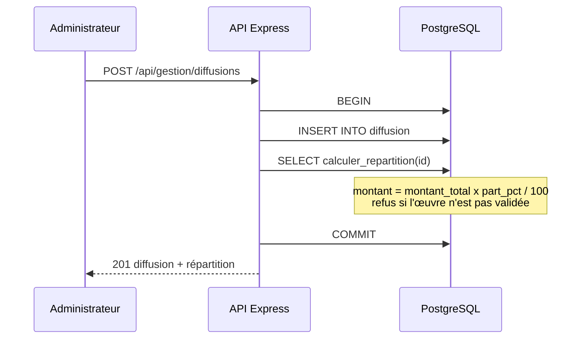

# Référence de l'API

[← Retour au README](../README.md)

Toutes les routes sont préfixées par `/api`. Les routes `/api/gestion/...` exigent un jeton de connexion (`Authorization: Bearer <jeton>`).

## Authentification

```bash
# L'API et la base répondent
curl http://localhost:3000/api/health

# Connexion : le jeton est rangé dans $TOKEN (Node est déjà installé, pas besoin de jq)
TOKEN=$(curl -s -X POST http://localhost:3000/api/auth/login \
  -H "Content-Type: application/json" \
  -d '{"email":"admin@nyhirako.example","password":"Admin123!"}' \
  | node -pe 'JSON.parse(require("fs").readFileSync(0)).token')

# Utilisateur connecté
curl http://localhost:3000/api/auth/me -H "Authorization: Bearer $TOKEN"
```

Les exemples des sous-sections suivantes utilisent `$TOKEN`.

## Routes des œuvres

| Méthode | Route | Accès | Description |
|---|---|---|---|
| GET | `/api/oeuvres?q=&genre=&annee=&page=&limit=` | Public | Recherche dans les œuvres **validées** (par titre ou par nom d'ayant droit) |
| GET | `/api/oeuvres/:id` | Public | Détail d'une œuvre validée avec ses contributions (`:id` est un UUID) |
| POST | `/api/oeuvres` | Public | Formulaire de soumission : crée l'œuvre en `EN_ATTENTE` |
| GET | `/api/gestion/oeuvres?statut=&q=` | Modérateur / Admin | Liste de toutes les œuvres, tous statuts |
| GET | `/api/gestion/oeuvres/:id` | Modérateur / Admin | Détail avec les informations de soumission, le statut, le type et le rôle de chaque ayant droit |
| POST | `/api/gestion/oeuvres` | Modérateur / Admin | Création directe |
| PUT | `/api/gestion/oeuvres/:id` | Modérateur / Admin | Modification (les contributions sont remplacées si elles sont fournies) |
| PATCH | `/api/gestion/oeuvres/:id/statut` | Modérateur / Admin | Validation ou rejet : `{"statut": "VALIDE"}` |
| DELETE | `/api/gestion/oeuvres/:id` | Modérateur / Admin | Suppression (refusée si l'œuvre a des diffusions) |

Une soumission peut référencer un ayant droit existant (`id_personne`) ou en créer un nouveau (`nouvelle_personne`), qui reste `EN_ATTENTE` jusqu'à sa validation.

```bash
# Recherche publique
curl "http://localhost:3000/api/oeuvres?q=salegy"
curl "http://localhost:3000/api/oeuvres?q=hery"

# Soumission publique (un ayant droit existant + un nouveau)
curl -X POST http://localhost:3000/api/oeuvres \
  -H "Content-Type: application/json" \
  -d '{
    "titre": "Mamelombelona", "genre": "Salegy", "annee_creation": 2025,
    "duree_sec": 210, "soumetteur_email": "test@example.com",
    "contributions": [
      {"id_personne": 1, "id_role": 2, "part_pct": 60},
      {"nouvelle_personne": {"type": "PHYSIQUE", "nom": "Rakoto", "prenom": "Jean"}, "id_role": 1, "part_pct": 40}
    ]
  }'

# Modération (avec le jeton obtenu au login dans $TOKEN)
curl "http://localhost:3000/api/gestion/oeuvres?statut=EN_ATTENTE" -H "Authorization: Bearer $TOKEN"
# <id_oeuvre> est l'identifiant renvoyé par la soumission ci-dessus
curl -X PATCH http://localhost:3000/api/gestion/oeuvres/<id_oeuvre>/statut \
  -H "Authorization: Bearer $TOKEN" -H "Content-Type: application/json" \
  -d '{"statut": "VALIDE"}'
```

La dernière commande est refusée (422) tant que l'ayant droit « Rakoto Jean » n'a pas été validé : c'est la règle appliquée par le trigger `trg_valider_oeuvre`.

## Routes des personnes et des rôles

| Méthode | Route | Accès | Description |
|---|---|---|---|
| GET | `/api/roles` | Public | Liste des rôles (pour le formulaire de soumission) |
| GET | `/api/personnes?q=&type=&ville=&page=&limit=` | Public | Recherche parmi les ayants droit **validés** (sans email, téléphone ni date de naissance) |
| GET | `/api/personnes/:id` | Public | Fiche d'un ayant droit avec ses œuvres validées |
| GET | `/api/gestion/personnes?statut=&q=&type=` | Modérateur / Admin | Liste de tous les ayants droit, tous statuts |
| GET | `/api/gestion/personnes/:id` | Modérateur / Admin | Fiche complète avec coordonnées et toutes les œuvres |
| POST | `/api/gestion/personnes` | Modérateur / Admin | Création (statut `VALIDE` directement) |
| PUT | `/api/gestion/personnes/:id` | Modérateur / Admin | Modification |
| PATCH | `/api/gestion/personnes/:id/statut` | Modérateur / Admin | Validation ou rejet : `{"statut": "VALIDE"}` |
| DELETE | `/api/gestion/personnes/:id` | Modérateur / Admin | Suppression (refusée si la personne a des contributions) |

```bash
# Rôles et recherche publique
curl http://localhost:3000/api/roles
curl "http://localhost:3000/api/personnes?q=njaka"
curl http://localhost:3000/api/personnes/1

# Modération : ayants droit en attente, puis validation
curl "http://localhost:3000/api/gestion/personnes?statut=EN_ATTENTE" -H "Authorization: Bearer $TOKEN"
curl -X PATCH http://localhost:3000/api/gestion/personnes/12/statut \
  -H "Authorization: Bearer $TOKEN" -H "Content-Type: application/json" \
  -d '{"statut": "VALIDE"}'
```

Pour une base déjà créée avant l'ajout des règles sur les ayants droit : `psql -d nyhirako -f db/migrations/001_regles_personnes.sql`.

## Routes des diffuseurs, diffusions et droits (administrateurs)

| Méthode | Route | Description |
|---|---|---|
| GET / POST | `/api/gestion/diffuseurs` | Liste (`q`, `type`, `ville`) et création |
| GET / PUT / DELETE | `/api/gestion/diffuseurs/:id` | Fiche, modification, suppression (refusée s'il a des diffusions) |
| GET | `/api/gestion/diffusions?id_oeuvre=&id_diffuseur=&date_debut=&date_fin=` | Liste filtrée des diffusions |
| POST | `/api/gestion/diffusions` | Enregistre une diffusion **et calcule la répartition** des droits |
| GET | `/api/gestion/diffusions/:id` | Diffusion avec le détail de sa répartition |
| PUT | `/api/gestion/diffusions/:id` | Modifie diffuseur, date ou montant, puis recalcule la répartition |
| POST | `/api/gestion/diffusions/:id/repartition` | Recalcule la répartition |
| DELETE | `/api/gestion/diffusions/:id` | Supprime la diffusion et sa répartition |
| GET | `/api/gestion/droits/personnes?q=` | Classement des ayants droit par total de droits perçus |
| GET | `/api/gestion/droits/personnes/:id` | Détail des droits d'un ayant droit, diffusion par diffusion |
| GET | `/api/gestion/statistiques` | Chiffres du tableau de bord (modérateurs et admins ; les montants sont réservés aux admins) |

Création d'une diffusion :



```bash
# Diffuseurs et diffusions existants
curl http://localhost:3000/api/gestion/diffuseurs -H "Authorization: Bearer $TOKEN"
curl "http://localhost:3000/api/gestion/diffusions?id_oeuvre=01036840-40db-4276-bf5e-c4a857badb3e" -H "Authorization: Bearer $TOKEN"

# Nouvelle diffusion de l'œuvre « Tanindrazako » : 200 000 Ar -> 80 000 / 80 000 / 40 000
curl -X POST http://localhost:3000/api/gestion/diffusions \
  -H "Authorization: Bearer $TOKEN" -H "Content-Type: application/json" \
  -d '{"id_oeuvre": "01036840-40db-4276-bf5e-c4a857badb3e", "id_diffuseur": 1, "date_diffusion": "2026-11-20", "montant_total": 200000}'

# Même chose pour « Alina Mamirapiratra », non validée : refusé (422), rien n'est créé
curl -X POST http://localhost:3000/api/gestion/diffusions \
  -H "Authorization: Bearer $TOKEN" -H "Content-Type: application/json" \
  -d '{"id_oeuvre": "f9a08ab6-8414-49b2-98f7-ba30fff802d1", "id_diffuseur": 1, "date_diffusion": "2026-11-20", "montant_total": 100000}'

# Classement des droits et détail pour un ayant droit
curl http://localhost:3000/api/gestion/droits/personnes -H "Authorization: Bearer $TOKEN"
curl http://localhost:3000/api/gestion/droits/personnes/1 -H "Authorization: Bearer $TOKEN"
```

Les montants sont exprimés en Ariary et renvoyés sous forme de chaînes (`"80000.00"`) pour éviter toute perte de précision.

## Gestion des erreurs

L'API traduit les erreurs PostgreSQL en codes HTTP :

| Erreur PostgreSQL | Code HTTP | Exemple |
|---|---|---|
| Violation d'unicité | 409 | Diffuseur déjà existant dans la même ville |
| Clé étrangère : élément encore utilisé | 409 | Suppression d'une œuvre déjà diffusée |
| Clé étrangère : référence inexistante | 422 | `id_diffuseur` qui n'existe pas |
| `CHECK` ou trigger | 422 | Somme des parts différente de 100 |
| Valeur invalide ou champ manquant | 400 | Statut inconnu |
